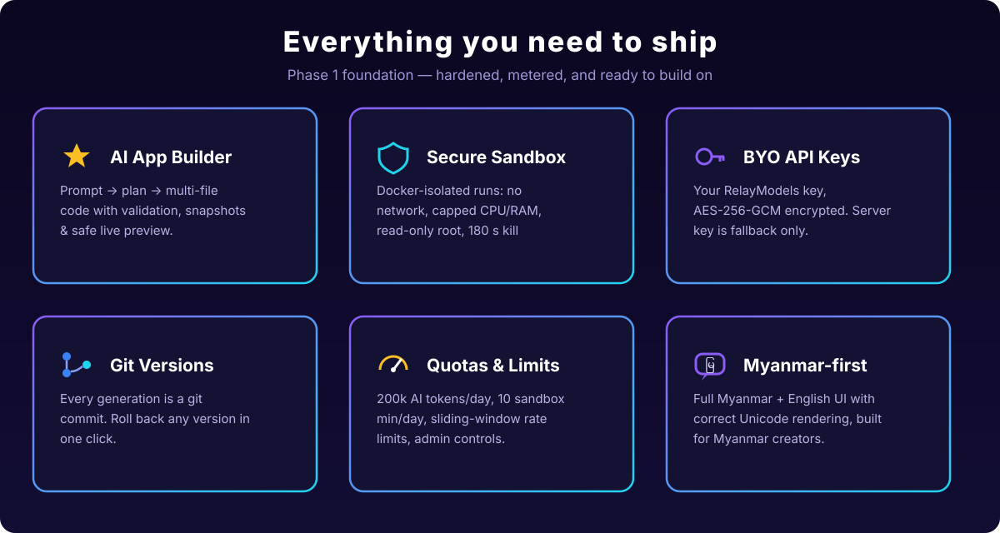
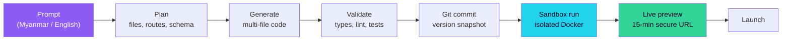

<div align="center">



[](https://alco.funapp.live)
[](LICENSE)
[](https://nextjs.org)
[](https://www.typescriptlang.org)
[](#testing)
[](#roadmap)

**Think it. Build it. Launch it.**

_Describe a web app in a single sentence — in Myanmar or English — and ALCO generates real, multi-file source code, runs it in an isolated sandbox, versions it with git, and helps you launch it._

> မြန်မာလို စာတစ်ကြောင်းရေးရုံနဲ့ ကိုယ်ပိုင် Web App တစ်ခု တကယ်ဖန်တီးနိုင်တဲ့ Platform — ALCO က ကုဒ်အစစ်ထုတ်ပေးပြီး၊ secure sandbox ထဲမှာ run ပေးကာ၊ launch လုပ်ဖို့ ကူညီပေးပါတယ်။

</div>

---

## Watch it think

<div align="center">



_One sentence in, twelve files out. Planned, generated, validated, sandboxed._

</div>

## Everything you need to ship

<div align="center">



</div>

## How it works



## Hardened by design

Generated code never touches the host. Every sandbox run is a locked-down Docker container:

```bash
--network none          # zero network access
--cpus 0.5              # CPU capped
--memory 512m           # RAM capped
--pids-limit 64         # fork-bomb proof
--read-only             # immutable root FS (+ tmpfs for /tmp)
--user 65532            # never root
--cap-drop ALL          # no Linux capabilities
# + no-new-privileges, 180 s kill switch, secrets scrubbed from logs
```

Preview URLs are unguessable 64-hex tokens, compared in constant time, expire after 15 minutes, and are served with a `Content-Security-Policy: sandbox` header.

**Metered, not wild:** 200k AI tokens/day · 10 sandbox minutes/day · 2 concurrent runs per user · 60 API req/min sliding-window rate limit · `/admin` gated by `ADMIN_EMAILS` (everyone else gets a 404).

## Your key, your bill — BYO API keys

ALCO never marks up AI. Bring your own [RelayModels](https://api.relaymodels.com) key in **Settings** — it's encrypted with AES-256-GCM and only a hint is ever shown back. No key? The server key acts as fallback. No key anywhere? You get an honest `api_key_missing`, not a silent failure.

## Quickstart

```bash
# 1. PostgreSQL — create the dev database
createdb alcoos_dev

# 2. Install
npm install

# 3. Configure
cp .env.example .env
# Edit .env: DATABASE_URL, BETTER_AUTH_SECRET (openssl rand -base64 32),
# BETTER_AUTH_URL=http://localhost:3000
# No AI key handy? AI_PROVIDER=mock gives canned replies for UI work.

# 4. Migrate + generate
npx prisma migrate dev
npx prisma generate

# 5. Run
npm run dev        # http://localhost:3000
```

<details>
<summary><b>Environment variables</b></summary>

| Variable | Purpose |
|---|---|
| `DATABASE_URL` | PostgreSQL connection string |
| `BETTER_AUTH_SECRET` | Session signing secret (`openssl rand -base64 32`) |
| `BETTER_AUTH_URL` | Public base URL (e.g. `https://alco.funapp.live`) |
| `AI_PROVIDER` | `relaymodels` (default), `openai`, or `mock` |
| `AI_API_KEY` | Server fallback key (optional — BYO is the primary path) |
| `AI_BASE_URL` | Gateway base URL (must include the `api.` subdomain) |
| `APP_ENCRYPTION_KEY` | AES-256-GCM key for stored user API keys |
| `ADMIN_EMAILS` | Comma-separated admin emails for `/admin` |
| `SANDBOX_DRIVER` | `docker` (production) or `local` (dev only) |

</details>

<details>
<summary><b>Scripts</b></summary>

| Script | What it does |
|---|---|
| `npm run dev` | Start the dev server |
| `npm run build` | Production build (must be error-free) |
| `npm run start` | Serve the production build |
| `npm run lint` | ESLint (must be error-free) |
| `npm test` | Vitest unit tests |

</details>

<details>
<summary><b>Project structure</b></summary>

```
src/
├── app/                    # Next.js App Router — pages, API routes
│   ├── api/                # chat, builder, sandbox, admin, billing…
│   ├── (auth)/             # sign-in / sign-up / reset
│   ├── builder/            # Monaco workspace + Run panel
│   └── admin/              # ADMIN_EMAILS-gated dashboard
├── components/             # shadcn/ui + app components
├── i18n/                   # EN / Myanmar dictionaries
├── lib/
│   ├── ai/                 # provider-agnostic adapter + mock provider
│   ├── sandbox/            # docker-driver / local-driver, runner, quotas
│   └── quotas.ts           # unified quota + sliding-window rate limits
prisma/                     # schema (16 models) + migrations
docs/blueprint-v1.0.md      # the original product blueprint
assets/                     # animated SVG art for this README
```

</details>

## Testing

**117/117 green** — `npm test` runs the Vitest suite: sandbox isolation proofs (timeout kill, secret scrubbing, cross-user 404s, traversal 400s), quota and rate-limit paths (including 429s), BYO-key resolution, and the full prompt→plan→generate pipeline on SQLite.

## Roadmap

- [x] **Phase 1 — AI App Builder** ✅ _live at [alco.funapp.live](https://alco.funapp.live)_
- [ ] **Phase 2 — Agent Team** · multi-agent coding crews
- [ ] **Phase 3 — Hosting** · one-click deploy from a preview
- [ ] **Phase 4 — Marketplace** · share, sell, and remix apps

## Docs

- [`docs/blueprint-v1.0.md`](docs/blueprint-v1.0.md) — the original product blueprint
- [`ARCHITECTURE.md`](ARCHITECTURE.md) — system design
- [`DEPLOY.md`](DEPLOY.md) — VPS deploy runbook
- [`AGENTS.md`](AGENTS.md) — contributor guide for AI agents

<div align="center">


</div>
